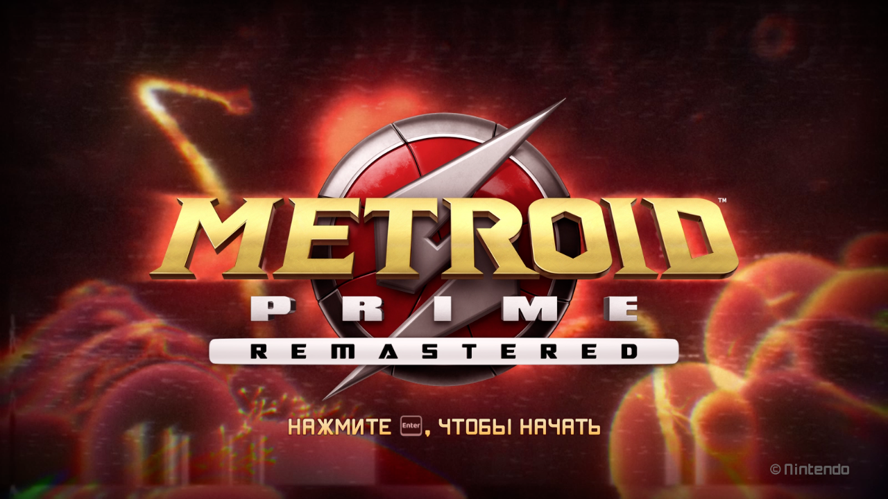
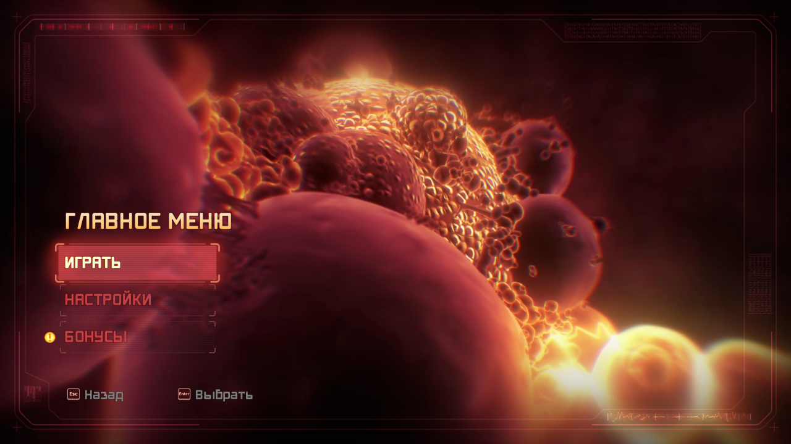
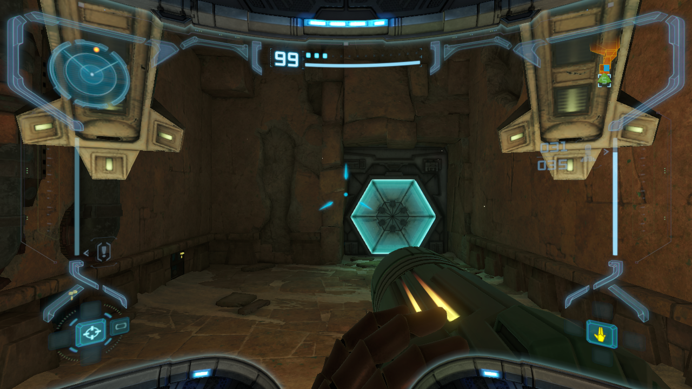
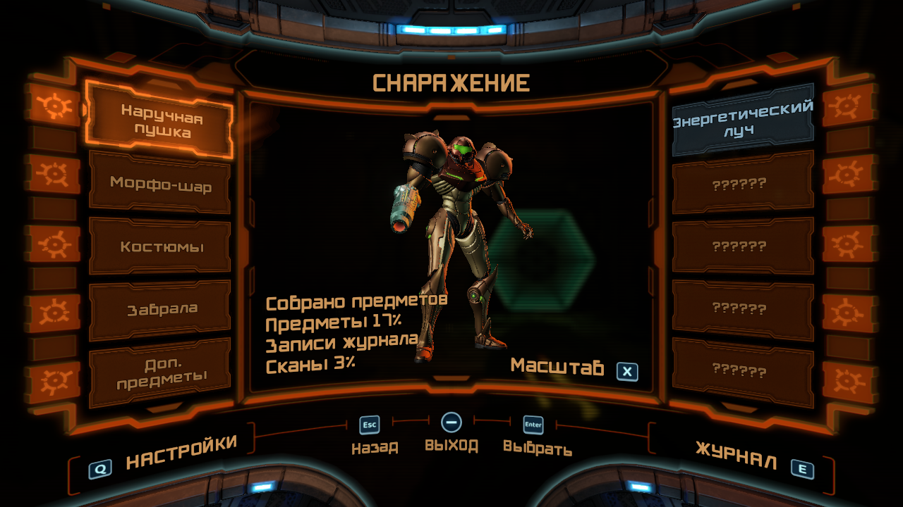
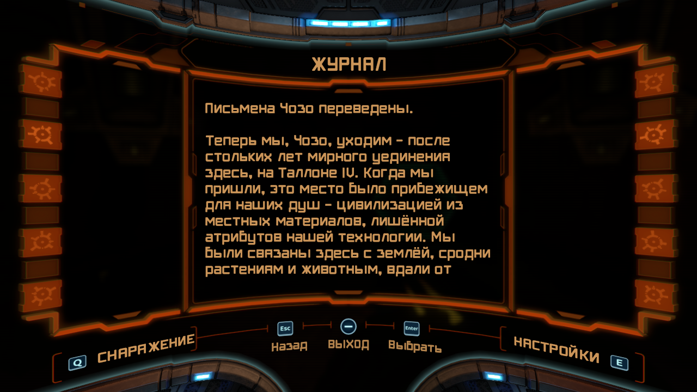
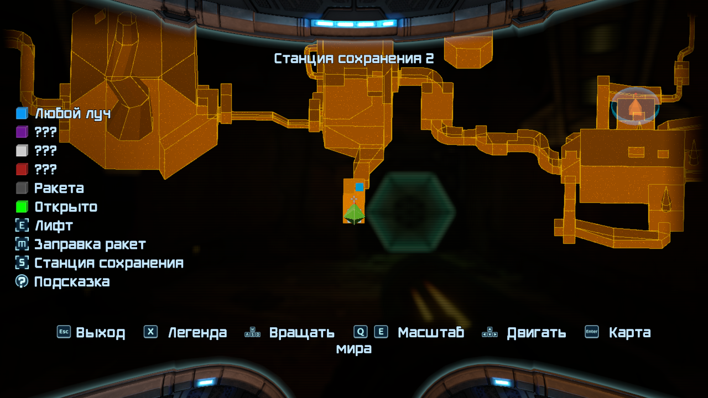

# Metroid Prime Remastered: русский перевод для PrimeRecomp

Русский текст и кириллица в шрифтах для [PrimeRecomp](https://github.com/gminustwo/primerecomp),
нативного ПК-порта Metroid Prime Remastered (Switch, v1.0.0): меню, настройки, подсказки, сканы,
журнал, карта, пауза, титры. Основа: перевод GameCube-версии
[metroid-prime-ru](https://github.com/454135431515/metroid-prime-ru), перенесённый в строки
Remastered; строки, которых не было на GameCube (меню, бонусы, новые подсказки), переведены здесь.

В репозитории нет данных Nintendo и ключей: мод собирается у каждого из его собственной копии игры.

| | |
|---|---|
|  |  |
|  |  |
|  |  |

## Что нужно
- [PrimeRecomp](https://github.com/gminustwo/primerecomp/releases): перевод проверен на **v0.0.9**
  (9 ноября 2026). Если на новой версии что-то сломалось,
  [откройте issue](https://github.com/454135431515/metroid-prime-remastered-ru/issues) с версией
  PrimeRecomp и файлом `primerecomp.log`;
- свой дамп **Metroid Prime Remastered v1.0.0** (`010012101468C000`) в формате NSP и `prod.keys`
  своей консоли. Это те же файлы, из которых настраивается сам PrimeRecomp;
- [Python 3](https://www.python.org/downloads/) (на Windows при установке отметьте
  «Add python.exe to PATH»).

## Установка
1. Установите и один раз запустите PrimeRecomp: на стартовом экране выберите свой NSP и нажмите
   **Set up**, как написано в его README.
2. Скачайте этот репозиторий: зелёная кнопка **Code → Download ZIP**, распакуйте в любую папку.
3. Откройте терминал в распакованной папке (Windows: в адресной строке Проводника наберите `cmd` и
   нажмите Enter) и поставьте пакеты Python:
   ```
   pip install -r requirements.txt
   ```
   Linux пишет `externally-managed-environment`: поставьте пакеты в отдельное окружение и дальше
   вместо `python3` запускайте `.venv/bin/python`:
   ```
   python3 -m venv .venv
   .venv/bin/pip install -r requirements.txt
   ```
4. Соберите мод. Если `prod.keys` лежит рядом с NSP, ключи указывать не нужно.

   **Linux** (мод сам ляжет в `~/.local/share/primerecomp/mods`):
   ```
   python3 install.py "/путь/к/Metroid Prime Remastered.nsp"
   ```
   **Windows** (папка `mods` лежит рядом с `PrimeRecomp.exe`, её нужно указать):
   ```
   py install.py "D:\Games\Metroid Prime Remastered.nsp" --mods "D:\Games\PrimeRecomp\mods"
   ```
   **macOS** (мод сам ляжет в `~/Library/Application Support/io.github.primerecomp/mods`):
   ```
   python3 install.py "/путь/к/Metroid Prime Remastered.nsp"
   ```
   Ключи в другом месте: добавьте `--keys "/путь/к/prod.keys"`. Сборка занимает секунды и пишет
   папку `russian` в `mods`; прежняя версия мода заменяется.
5. Запустите PrimeRecomp. Мод включается сам; проверить можно в меню **F1 → Mods**: там должен быть
   включён `russian`.

Если игра осталась на английском или на другом языке: **F1 → Controls → Language → English**.
Перевод заменяет английский текст, поэтому язык игры должен быть английским. На Windows и macOS
так по умолчанию; на Linux PrimeRecomp берёт язык системы (русская система тоже даёт английский).

## Обновление
Скачайте свежую версию репозитория и повторите шаги 3–4: новый мод заменит старый.
После обновления самого PrimeRecomp мод пересобирать не нужно.

## Удаление
Удалите папку `russian` из папки `mods` PrimeRecomp или выключите её в **F1 → Mods**.

## Не выкладывайте собранный мод
Папка `russian` содержит изменённые файлы игры (архивы `.pak` со шрифтами и текстом).
Раздавайте этот репозиторий, а не результат сборки.

## Для разработки
Перевод правится в [metroid-prime-ru](https://github.com/454135431515/metroid-prime-ru); здесь лежат
копии кода шрифтов (`tools/gc/`) и готовая таблица строк (`text/ru-labels.json`), их обновляет
`tools/sync_gc.py` (ADR 0004). Строки только из Remastered: `text/ru-remastered.json`.
Все проверки: `tools/test.sh`. Тикеты лежат в `docs/tickets/`, решения в `docs/adr/`.

## Лицензия
Код под лицензией MIT, см. `LICENSE`. Перевод (`text/`) под CC BY 4.0, см. `text/LICENSE`.
Metroid Prime является товарным знаком Nintendo; проект с Nintendo не связан.

---

**English.** A Russian translation of Metroid Prime Remastered (Switch v1.0.0) for
[PrimeRecomp](https://github.com/gminustwo/primerecomp) (checked on v0.0.9), based on the
[GameCube translation](https://github.com/454135431515/metroid-prime-ru). No Nintendo data or keys
are included: run `pip install -r requirements.txt`, then `python3 install.py <your game.nsp>`
(with `prod.keys` next to it; on Windows add `--mods <PrimeRecomp folder>\mods`). The game language
must be English (F1 → Controls → Language). Code is MIT, translation text is CC BY 4.0.
